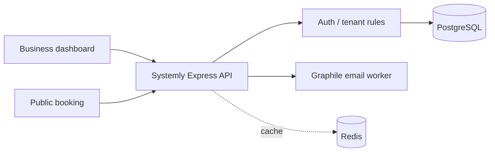
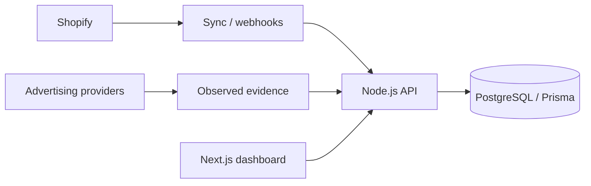

# Ahmed Abdelrahman — Backend Software Engineer

**Node.js · TypeScript · PostgreSQL · Multi-Tenant SaaS · Distributed Systems**

I build backend-heavy products, from multi-tenant booking platforms to Shopify commerce intelligence. My engineering focus is secure authorization, robust APIs, provider integrations, asynchronous processing, and deployments that are testable and maintainable.

[GitHub](https://github.com/Ahmed2902) · [LinkedIn](https://www.linkedin.com/in/ahmedabdelrahman2002/)

## Featured engineering projects

| Project | What it demonstrates | Links |
| --- | --- | --- |
| **Metrico** | Shopify commerce intelligence; tenant-scoped data, integrations, asynchronous synchronization and evidence-aware reporting | [Product website](https://metrico.live) · Source private |
| **Systemly** | Booking and business operations SaaS; timezone-aware scheduling, race-safe booking, role authorization, durable email jobs | [Product website](https://systemly.me) · [API](https://github.com/Ahmed2902/SystemlyBackEnd) · [Frontend](https://github.com/Ahmed2902/Systemly-frontend) |
| **Smart Workforce** | Node.js/TypeScript microservices; RabbitMQ messaging, PostgreSQL/Prisma, Redis and Docker orchestration | [Repository](https://github.com/Ahmed2902/Smart-workforce) |
| **Rawy** | Expressive text-to-speech graduation work using NLP, language models and audio composition | Public source not currently listed |

### Systemly architecture

### Metrico architecture

*The diagrams are high-level and intended as technical overviews. Metrico source remains private; its public product link is not a promise of current site availability.*

## Technical toolkit

- **Backend:** Node.js, Express, TypeScript, REST APIs, OAuth, webhooks, background jobs.
- **Data:** PostgreSQL, Prisma ORM, Redis, RabbitMQ, multi-tenant architecture.
- **Quality and operations:** Jest, Vitest, Docker, GitHub Actions, Azure Container Apps, Supabase.
- **Other:** Next.js, React, Python and applied ML/NLP.

## Education

B.Sc. in Computer Science, Ain Shams University (2025), GPA 3.68/4.00.

---

This page is a *portfolio index* in the GitHub Pages configuration repository; it is not a source-code repository for the individual products.
